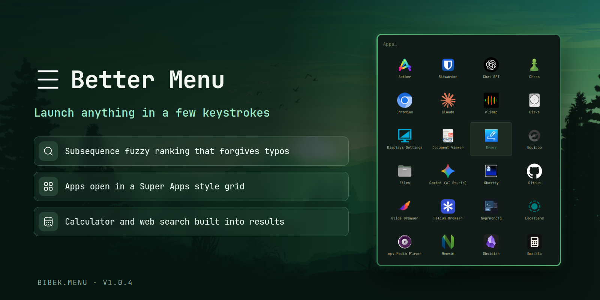

# Better Menu

Clone of the built-in `omarchy.menu` with subsequence fuzzy ranking, an app grid, a calculator and customizable web search.



## Differences from the built-in menu

- **Fuzzy matching.** Filtering uses the same subsequence scorer as `bibek.obsidian-search` (word-boundary and consecutive-character bonuses, multi-token queries), replacing the built-in substring tiers. `zenbrow` ranks Zen Browser first, where substring matching finds nothing.
- **App grid.** The Apps menu renders as an icon grid in the style of `super-apps` instead of a list. In grid mode Up/Down jump a full row, Left/Right step one cell, PageUp/PageDown jump three rows. Everywhere else the list behavior is unchanged.
- **Calculator.** Typing a math expression (numbers with `+ - * / % ^` and parentheses, e.g. `2*(3+4)^2`) shows the result as the top row, but only in the root menu. Enter copies it to the clipboard.
- **Web search row.** Any query in the root menu appends a `Search <engine>` row at the bottom with the query and host as its detail. Enter opens it in the browser.
- **Send to agent row.** When a default agent is set (`omarchy default agent`), any query also appends a `Send to <agent>` row below the web search row. Enter launches that agent with the query as its prompt. The row is on by default and can be turned off with `sendToAgent` in the config below.
- **Extended keymap.** Ctrl+J / Ctrl+K and Ctrl+N / Ctrl+P move one row, Ctrl+H / Ctrl+L move left and right, Home / End jump to the first / last result. Everything else matches the built-in menu: Up/Down move, PageUp/PageDown jump 6, Enter (or Right in list mode) activates, Esc clears the filter first and closes on the second press, Backspace goes back when the filter is empty.

## Search engine

The web search row reads `~/.config/omarchy/menu.json` (watched live, so edits apply instantly):

```json
{
  "searchEngine": "duckduckgo"
}
```

`searchEngine` is either a preset name (`google`, `duckduckgo`, `bing`, `brave`) or a full URL containing `%s` for the query. Missing, empty or unknown values fall back to Google.

## Send to agent

The same file controls the agent row. It is enabled by default, and the agent is whatever `omarchy default agent` reports (read from `~/.config/omarchy/defaults/agent`), so no agent name is hardcoded. With no default agent set, the row does not appear.

```json
{
  "sendToAgent": true,
  "agentDirectory": "~/Code/my-project"
}
```

`sendToAgent` set to `false` hides the row. `agentDirectory` is where the agent starts; it defaults to `~`, accepts `~/...` and absolute paths, and relative values resolve under your home directory. Selecting the row runs `omarchy agent prompt "<query>"` from that directory.

## Notes

- Ranks, icons, launch, removal and hidden-entry filtering behave exactly like the built-in menu. When the shell withholds its app library (Omarchy 4.0.3 does this for third-party plugins), the plugin reads Quickshell's desktop entries directly through the shell's own ranking and hide lists, and switches back automatically once the host provides the library again.
- Calculator and web search rows only appear in the root menu, never in submenus or dmenu mode.

## Requirements

Omarchy quattro. No extra dependencies.

## Install

```bash
omarchy plugin add https://github.com/BibekBhusal0/omarchy-better-menu.git --enable
```

**Important**: If you have `omarchy.dock` disabled, the apps menu won't work by default because the built-in config tries to open the dock. Override this by creating `~/.config/omarchy/extensions/omarchy-menu.jsonc`:

```json
{
  "apps": {
    "icon": "󰀻",
    "label": "Apps",
    "aliases": ["app", "applications"],
    "provider": "apps"
  }
}
```

This removes the dock action and shows apps in the menu itself. This is the setting I recommend because it has keyboard shortcuts for moving up/down/left/right with Ctrl+k/j/h/l.

## Open All Apps with the Super key

To open the app grid with a tap of the Super key, add to `~/.config/hypr/bindings.lua`:

```lua
o.bind("SUPER + SUPER_L", "Apps", "omarchy-shell shell toggle bibek.menu '{\"menu\":\"apps\"}'")
```

## Uninstall

```bash
omarchy plugin remove bibek.menu
```

## Credits

- Menu system, providers and styling cloned from Omarchy's built-in `omarchy.menu`.
- Subsequence scorer shared with `bibek.obsidian-search`.
- App grid inspired by [younesdahdouh/omarchy-super-apps](https://github.com/younesdahdouh/omarchy-super-apps).
- Direct desktop-entry fallback parallels the workarounds in [maajix/omarchy-spotlight](https://github.com/maajix/omarchy-spotlight) and [evindor/keystroke](https://github.com/evindor/keystroke).
- Bullet icons from [HugeIcons](https://hugeicons.com) via the Iconify API.

## Others

Here are my other Omarchy plugins:

- [Focusd](https://github.com/BibekBhusal0/omarchy-focusd) - pomodoro timer with streak, history and daily goal
- [Better Lock](https://github.com/BibekBhusal0/omarchy-better-lock) - lock screen with date/time, media and power controls
- [Better Media](https://github.com/BibekBhusal0/omarchy-better-media) - MPRIS now-playing with playback controls
- [Obsidian Search](https://github.com/BibekBhusal0/omarchy-obsidian-search) - fuzzy-search your Obsidian vault
- [Readest](https://github.com/BibekBhusal0/omarchy-readest) - fuzzy-search your Readest library
- [Youtube Video Downloader](https://github.com/BibekBhusal0/omarchy-ytdl) - video downloads with progress and history

Please give a star if you find them useful!
